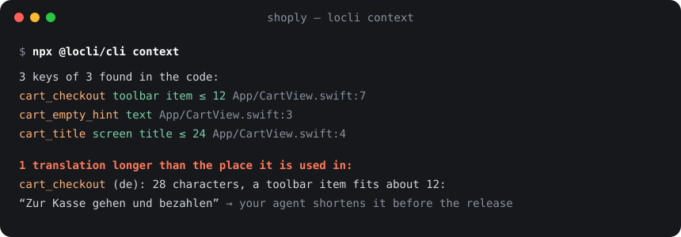

# locli

**Localize your app with your coding agent.** [locli](https://locli.dev) is the one place for the
texts of your iOS, Android, web and backend app and its store listings. Your agent moves the
texts into the app's catalog, uploads and translates them; locli checks every one; nothing ships
until a person approves the release.



## How it works

1. **Your agent writes the texts where they belong:** `Localizable.xcstrings`, `strings.xml` or
   ICU JSON, under stable keys like `cart_checkout`, never hard-coded strings.
2. **`locli push`** uploads new keys and texts and never overwrites what translators changed.
3. **The agent translates** with your project's tone, glossary and the place each text appears.
   `locli context` finds that place in the code: a toolbar item fits about 12 characters, a
   screen title about 24. Placeholders, plurals and glossary terms are checked on every upload.
4. **You approve a release** in the locli web app, per language, with a diff of what changed.
5. **`locli pull`** writes exactly that release into the app. Builds stay reproducible.

Works with Claude Code, Cursor, Codex and any MCP client; no lock-in to one agent.

This repository holds what runs on your machine:

| Folder | What |
| --- | --- |
| [`cli/`](cli) | `@locli/cli`: `init`, `login`, `push`, `pull`, `status`, `context`, `areas`, `guide` and the MCP server (`npx -y @locli/cli mcp`) |
| [`plugin/`](plugin) | The Claude Code plugin: a skill that tells the agent when and how to use locli, plus the MCP server |
| [`cli/skill/`](cli/skill) | The full agent skill that `locli init` installs into a repository |

## Get started

In your app's repository:

```sh
npx @locli/cli init
```

Or ask your coding agent: *"Set up locli for this app's texts."* (docs: https://locli.dev/docs/agents.md).

### Claude Code

```text
/plugin marketplace add mariohahn/locli
/plugin install locli@locli
```

### Cursor, Codex and other MCP clients

```json
{ "mcpServers": { "locli": { "command": "npx", "args": ["-y", "@locli/cli", "mcp"] } } }
```

Sign in once with `npx @locli/cli login` (it opens the browser to approve the CLI). CI uses
a project token in `LOCLI_TOKEN`.

## Data

The CLI and MCP server talk to one service: the locli server in `locli.json` (`apiURL`,
default https://locli.dev, hosted in Frankfurt). They send the app's texts, their keys,
comments and plural forms, and short usage notes such as "used as a toolbar item"; they do not
send source code or file contents. Texts stay in the locli project until it is deleted. The
sign-in token is stored in `~/.config/locli/credentials.json` (or `$XDG_CONFIG_HOME`), readable
only by you. Privacy policy: https://locli.dev/app/privacy/

## Issues

Bugs and ideas: [open an issue](https://github.com/mariohahn/locli/issues). The locli server and
web app are not part of this repository.

License: MIT
